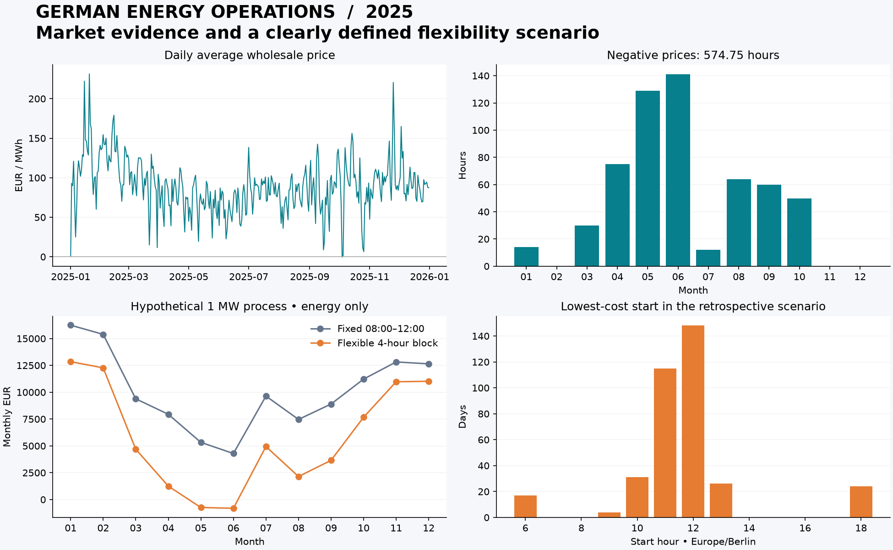
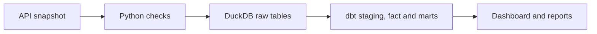

# German Energy Operations Analytics

[](https://github.com/MUmairSarwar/german-energy-operations/actions/workflows/ci.yml)

A Python, SQL and dbt project on 2025 German electricity data. It builds a tested DuckDB warehouse from public day-ahead prices and generation/load data, and uses it for one concrete question:

> A process has to run for four consecutive hours every day. If its start time could move between 06:00 and 18:00, how much lower would its 2025 day-ahead energy cost have been than with a fixed 08:00 start, and which assumptions could make that number meaningless?

The answer is a retrospective scenario on public market data. It is not a measured or achieved saving, and no employer or customer data is involved.



## Results

From the included snapshot of the 2025 data ([`reports/metrics.json`](reports/metrics.json)):

| Market fact, 2025 | Value |
|---|---:|
| Quarter-hour intervals | 35,040 (8,760 h) |
| Time-weighted DE-LU day-ahead price | €89.32/MWh |
| Hours with a negative price | 574.75 |
| Price range | €−250.32 to €583.40/MWh |
| Wind + solar generation / German load | 43.2% |

The last ratio compares energy sums. It is not the renewable share (hydro and biomass are missing) and not the mix any particular site consumes.

For a hypothetical constant 1 MW process (4 MWh per day, every calendar day):

| Scenario | Value |
|---|---:|
| Eligible days | 365 |
| Cost with fixed 08:00 start | €121,261.79 |
| Cost with the cheapest start between 06:00 and 18:00 | €69,896.86 |
| Gross difference | €51,364.94 (42.4%) |
| Days where the cheapest start was not 08:00 | 365 |

That is €140.73 per day. It is an upper bound on what a fixed daily cost of moving the process could be before the scenario stops paying, and it ignores grid fees, taxes, levies, start/stop costs, staffing and throughput limits. Costs scale linearly with process power, so a 100 kW process would see one tenth of these amounts. The [executive summary](reports/executive_summary.md) turns this into a proposal for a shadow pilot rather than a savings claim.

## Method

**Scheduling rule** ([`mart_schedule.sql`](dbt/models/marts/mart_schedule.sql)). For each local date, a window function sums the cost of every block of 16 consecutive quarter-hours starting on a whole hour between 06:00 and 18:00 (Europe/Berlin), so each block ends by 22:00. A block counts only if all 16 quarters have a price and the last one starts exactly 3 h 45 min after the first, which keeps blocks intact across the daylight-saving changes. A day is eligible only if all 13 candidate blocks are complete. `arg_min` picks the cheapest block, and ties go to the earliest start. Because 08:00 is one of the candidates, the flexible cost can never exceed the baseline.

Only that day's day-ahead prices drive the choice; realised generation and load never do. The API returns final historical values without publication timestamps or revision history, so this is a benchmark on the historical price curve, not a verified point-in-time backtest.

**Interval handling** ([`normalize.py`](src/energy_ops/normalize.py)). Every row is keyed by its UTC start. Before 1 October 2025 the day-ahead market cleared hourly, and each hourly price is applied to its four quarter-hours. From that date prices are native 15-minute values. The interval length comes from this fixed rule, not from the gap to the next row, so a missing interval stays missing. Local dates and hours are derived in Europe/Berlin, which gives 23- and 25-hour days at the clock changes.

**Metric definitions.**

- Energy per quarter-hour: MW × 0.25 h.
- Scenario cost: price (EUR/MWh) × process power (MW) × 0.25 h, summed over the block.
- Average price: weighted by time over observed quarters. A plain average over source rows would overweight the 15-minute period at the end of the year.
- Negative-price hours: number of negative quarters × 0.25.
- Wind/solar ratio: ratio of energy sums over quarters where all series are present, not an average of ratios.
- Missing values are never filled with zero or carried forward.

**Warehouse and tests.** Ingestion checks the snapshot's SHA-256 hash, required fields, array lengths, unique increasing timestamps, quarter-hour alignment, the price unit and non-negative physical quantities. dbt then builds six models (a staging join onto an expected time spine, a date dimension, a quarter-hour fact table, and daily, schedule and quality marts). The 20 dbt data tests cover full-year coverage, unique keys, the daylight-saving days, unit arithmetic and reconciliation of the schedule costs. The 24 pytest tests cover synthetic edge cases in the interval logic, SQL fixtures for the schedule and the dashboard controls. Both suites passed locally and in GitHub Actions for the recorded commit ([`reports/validation.json`](reports/validation.json)).



**Dashboard** ([`app.py`](app.py)). Streamlit and Plotly. A reviewer can filter months, change the process power and subtract an assumed cost for each day the start moves. The schedule is not re-optimised under that cost, so the adjusted figure can turn negative, which is the point of the control.

More detail is in the [methodology notes](docs/methodology.md).

## Run locally

Python 3.12 is the tested version. No API key or cloud account is needed.

```bash
python -m venv .venv
source .venv/bin/activate          # Windows PowerShell: .venv\Scripts\Activate.ps1
python -m pip install -r requirements-lock.txt
python -m pip install --no-deps -e .
python -m energy_ops.pipeline      # build the warehouse, run dbt build and tests, export reports
python -m pytest -q
python -m streamlit run app.py
```

Run the commands from the repository root. Installation needs internet access; the pipeline itself works offline from the included snapshot. It stops before exporting reports if a dbt test fails, but reports from an earlier run are not deleted, so check the exit status. The same steps are available as `make setup`, `make analyse`, `make test` and `make dashboard`.

To download the data again (only when intended, since the API may have revised values):

```bash
python -m energy_ops.ingest --refresh
python -m energy_ops.pipeline
```

To run dbt directly, set `ENERGY_DB_PATH` to the absolute path of `warehouse/energy.duckdb` and pass `--project-dir dbt --profiles-dir dbt`. The pipeline does this automatically. Generated lineage documentation is written to `dbt/target/` and can be viewed with `dbt docs serve --project-dir dbt --profiles-dir dbt`.

## Repository structure

| Location | Contents |
|---|---|
| `src/energy_ops/` | Snapshot download, interval checks, pipeline and report generation |
| `dbt/models/staging/` | Expected time spine with source joins that keep missing values |
| `dbt/models/marts/` | Date dimension, quarter-hour fact, daily KPIs, schedule and quality marts |
| `dbt/tests/` | Coverage, daylight-saving, unit and reconciliation tests |
| `tests/` | Interval edge cases, SQL fixtures and dashboard tests |
| `data/` | Compressed source snapshot, attribution and provenance |
| `reports/` | Metrics, CSV marts, overview figure and executive summary |
| `docs/` | Methodology |

## Limitations

- Energy-only costs. Grid tariffs, taxes, levies, imbalance charges, ramping, minimum run times, staffing and throughput are not modelled.
- The process is hypothetical, with constant power and the same rule on every day including weekends.
- Prices are for the DE-LU bidding zone while generation and load are German national series, so the generation figures are context only.
- The year and the switch to 15-minute prices are fixed to 2025. Using another year would need the interval rule and tests to be updated.
- The project runs locally on DuckDB, dbt and Streamlit. It does not include Power BI, Airflow, a cloud warehouse or a production deployment. A more realistic operating calendar and a BI semantic model would be reasonable next steps.

## Sources and licences

Data from [Energy-Charts.info](https://api.energy-charts.info/) (Fraunhofer ISE); the price data is credited to Bundesnetzagentur / SMARD.de. Both are used under [CC BY 4.0](https://creativecommons.org/licenses/by/4.0/). See the [data notes](data/README.md) for what the snapshot keeps and [provenance.json](data/provenance.json) for exact request URLs and hashes. Code: [MIT](LICENSE).

## History

I did the initial analysis from January to March 2026. The final data snapshot was taken on 3 October 2026, and the pipeline, dashboard and tests were committed the same day. Later commits changed documentation and licence text only. All numbers above come from that snapshot of 2025 data.

Author: [Muhammad Umair Sarwar](https://github.com/MUmairSarwar) · [LinkedIn](https://www.linkedin.com/in/muhammad-umair-sarwar/)
